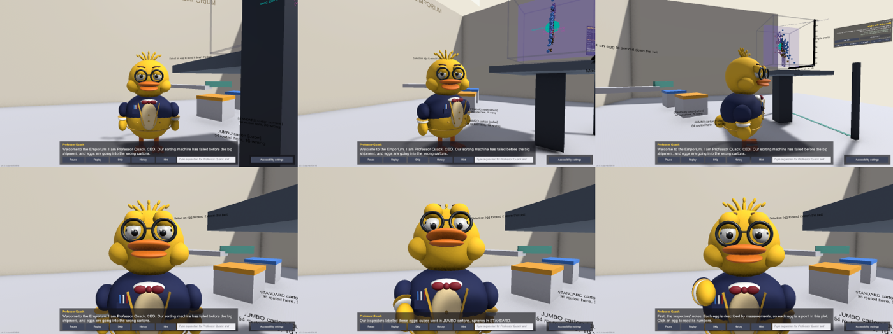
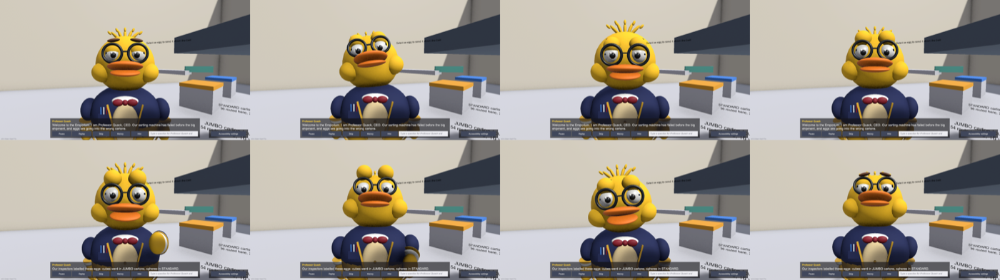
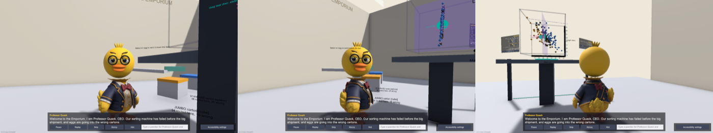

# Professor Quack — character pipeline

Canonical design: **Design A** ([reference/prev_asset/](../reference/prev_asset/)). Design B is discontinued.
Team brief: [reference/prof_quck_design.md](../reference/prof_quck_design.md).

## Approach (approved)

Hybrid character:

| Part | Source | Why |
|---|---|---|
| Body + outfit (blazer, vest, bow tie, pens, wings, legs, feet, tail) | Generated mesh (Higgsfield → Tripo), processed in Blender | Detail where generation is good |
| Head + face (eyes with pupils, eyelids, eyebrows, black round glasses, two-part beak, tuft) | Procedural, code-controlled (`QuacksRig.BuildHead` / `BuildFace`) | Baked eyes/glasses can't animate; Tripo gives no blendshapes |
| Animation | Existing `QuacksAnimator` (emotions, gestures, gaze, blink, speech beak, duck habits) | One animation system for stand-in and generated body |

Until an approved generated body exists, the game uses a **Design A stand-in** built from primitives with the same face system (v0.9.0: brown-iris eyes, wide bill, cheeks, curved tuft, gold hem/cuff piping, three-toed feet). Acting: aimed pointing at the real object being discussed, breathing, small nods while speaking, a hop when celebrating, a step back when surprised; all reduced under Reduced motion.





The generated-body import path has been dry-run end to end with the earlier (rejected) export — headless body, textured, rigged, with the procedural head attached:



## 1. Generate the body (Tripo multiview) — do this before spending credits

Official requirements ([Tripo docs](https://developers.tripo3d.com/en/docs/generation-multiview-to-model/standard.md)):
- Views are **front, left, back, right** — labelled (recommended) or positional in exactly that order.
- **Front is required**; others optional; at least 2 images.
- **Three-quarter views are not a supported input.** (Our previous attempt sent 3/4, front, back, side in one array — if passed positionally, Tripo read the frontal face as the *left* view, which matches the duplicated faces we saw. Unverified because the Higgsfield integration's mapping is unknown.)

Ready-to-upload crops from the Design A turnaround (`Professor Quack Character Turnaround.png`): [reference/design_a/views/](../reference/design_a/views/)

| Tripo slot | File | Note |
|---|---|---|
| front | `quacks_front.png` | required |
| left | `quacks_left.png` | beak points to screen-left; pens pocket visible ⇒ his left side (standard left view) |
| back | `quacks_back.png` | |
| right | `quacks_right.png` | a real right view from the sheet (not mirrored) |

Recommended settings: model version `v3.1-20260211`, `texture: true`, `pbr: true`, **`face_limit: 50000`** (game budget instead of 1.5M), `quad: false`.

**Cheapest safe order:** (1) front + back only (no side-convention risk) → inspect; (2) if good, add left + right in labelled form.
**Pass labelled views** (`{"front": …}, {"left": …}, …`) if Higgsfield exposes them; if it only takes an unlabelled array, send exactly `[front, left, back, right]`.

## 2. Accept or reject (inspect before any work)

Render four sides first (Blender, ~1 min): `Blender -b --python tools/blender/prepare_quacks.py -- <in.glb> /tmp/x.fbx --front <axis> --preview /tmp/prev`

- [ ] Exactly two eyes and one pair of glasses (on the head we will strip anyway, but duplicates signal a broken body too)
- [ ] One beak, no faces on the sides/back
- [ ] Two wings, two legs, two webbed feet, one tail
- [ ] Outfit matches Design A (navy blazer, gold piping, cream vest, burgundy bow tie, pens)
- [ ] No large floating fragments

## 3. Process for Unity

```
Blender -b --python tools/blender/prepare_quacks.py -- <approved.glb> Assets/_Quack/Resources/Characters/ProfessorQuack.fbx \
        --front <axis> --tris 40000 --strip-head --preview /tmp/quack
```
- `--front`: which axis the model faces (`-Y`, `+X`, `+Y`, `-X`); check the preview — the face must be in the `_front` render. The earlier export faced `+X`.
- Writes `ProfessorQuack.fbx` + `ProfessorQuack_basecolor.png`; prints joint positions and weights. Override joints with `--joints joints.json` if proportions differ.
- Commit both files (they're the approved asset). Raw exports stay in `reference/raw/` (git-ignored).

## 4. Use it in the game

- Launch with `-quackCharacter ProfessorQuack` (loads `Resources/Characters/ProfessorQuack`). Without the flag, the stand-in is used.
- Check `Player.log` for `QUACK_CHARACTER loaded … texture=True bones body=… head=… wings=True/True`.
- Review: `tools/win.sh portrait -quackCharacter ProfessorQuack` → screenshots in `Logs/remote/tour/`.
- When approved, make it the default (one line in `QuackGame`), release, and update this doc.
- Releases refuse to build if any `*dryrun*` character file is in the project.
